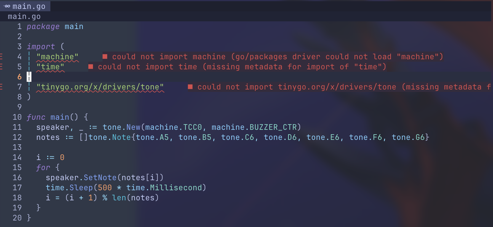
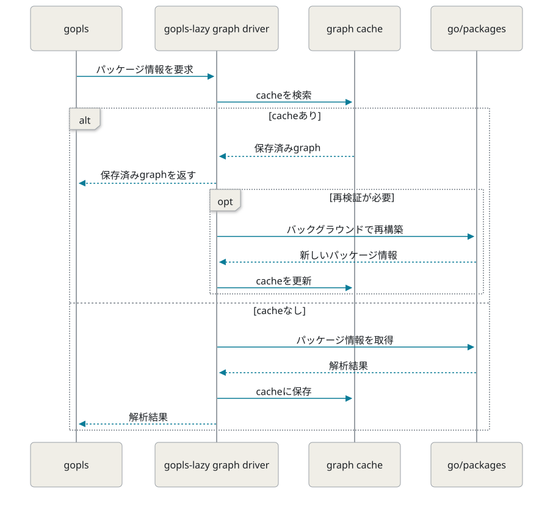

<!-- _class: cover -->

# tinygo.vimとgopls-lazyが<br>噛み合わなかった話

Rinrin — [@rin2yh](https://x.com/rin2yh)

---

<!-- _class: profile -->

## 自己紹介


| | |
|---|---|
| 名前 | Rinrin |
| 職種 | フルスタックエンジニア |
| 趣味 | アニメ、ゲーム、キーボード |
| ひとこと | 最寄り駅から田町まで直線距離14.3km |

<!-- 口頭：最寄り駅から田町まで直線距離で約14.3kmです。 -->

---

## 目次

1. 前提
2. 起きたこと
3. 原因の調査
4. 対応

---

<!-- _class: section -->

SECTION 01

# 前提

---

## [tinygo.vim](https://github.com/sago35/tinygo.vim)とは

- TinyGo向けのVim/Neovimプラグイン
- `:TinygoTarget` でターゲットに応じた設定を適用
- `GOROOT`、`GOOS`、`GOARCH`、`GOFLAGS` をgoplsに設定
- 設定後にgoplsを再起動


---

## [gopls-lazy](https://github.com/sivchari/gopls-lazy)とは

- goplsの前段で動作するLSPプロキシ
- 大規模ワークスペースでの解析負荷を軽減
  - 解析範囲の制御
  - パッケージ情報のキャッシュ

<!-- 口頭：Asakusa.goで知りました。副業先の特大モノレポでgoplsが重かったため導入しました。 -->

---

## 今回の開発環境

- Neovim + gopls-lazy + tinygo.vim
- TinyGoでは通常のGoと異なる環境でパッケージを解析する
  - 例：`wioterminal` では `GOOS=linux`、`GOARCH=arm`、TinyGo用の `GOROOT` を使用
- `.tinygo.json` でターゲットを指定
- dotfiles側で `:TinygoTarget` を自動実行

```json
{
  "target": "wioterminal"
}
```


---

<!-- _class: section -->

SECTION 02

# 起きたこと

---

## NeovimでTinyGoのパッケージを解決できない



<!-- 口頭：machineやtimeなどのパッケージでimportエラーが発生し、補完や定義ジャンプも正常に動作しませんでした。 -->

---

## `machine` のパッケージ解決はどこで失敗するのか？

**TinyGoの環境を揃えて、実行方法ごとに比較**

| 検証方法 | `machine` の解決 |
|---|---|
| `go list machine` | 成功 |
| `go list ./...` | 成功 |
| gopls | 成功 |
| gopls-lazy v0.4.1 | 失敗 |

**→ gopls-lazyを経由した場合にのみ失敗**

<!-- 口頭：まずTinyGoのgo listでパッケージが解決できることを確認し、続いてgoplsを直接起動した場合とgopls-lazyを経由した場合を比較しました。 -->

---

<!-- _class: section -->

SECTION 03

# 原因の調査

---

## 仮説①：gopls-lazyがTinyGoの環境変数を引き継いでいない

**検証：gopls-lazyと、そこから起動されたgoplsの環境変数を確認**

| プロセス | `GOROOT` | `GOOS` | `GOARCH` | `GOFLAGS` |
|---|---|---|---|---|
| gopls-lazy | TinyGo用 | `linux` | `arm` | wioterminal用 |
| gopls | TinyGo用 | `linux` | `arm` | wioterminal用 |

**結果：どちらのプロセスにもTinyGoの環境変数が設定されていた**


---

## 仮説②：古いgraph cacheが再利用されている

gopls-lazyはパッケージ情報を **graph cache** に保存し、再利用する。

**検証方法**
- 保存済みの解析結果をコピーした保存先を用意
- 過去の解析結果がない保存先も用意
- 同じTinyGo環境で、それぞれを使って解析

**検証結果**

| 保存先の状態 | `machine` の解決 |
|---|---|
| 保存済みの解析結果あり | 失敗 |
| 保存済みの解析結果なし | 成功 |

**→ 保存済みの解析結果がパッケージ解決に影響していた**

<!-- 口頭：gopls-lazyはmacOSでは通常、HOME配下のLibrary/Caches/gopls-lazyに解析結果を保存します。起動時のHOMEを変えると保存先を分けられるため、元のデータを消さずに比較できます。今回は保存済みの解析結果をコピーした保存先と、過去の解析結果がない保存先を用意し、同じTinyGo環境でmachineが解決できるか比べました。HOMEの変更はコードから確認できる切り替え方法であり、当時の具体的な操作コマンドは未確認です。 -->

---

## 保存済みの解析結果を確認

**検証方法**
- graph cacheファイルを開く
- `machine` のパッケージ解決エラーを確認
- エラーが参照する `GOROOT` を確認

**検証結果**
- `machine` の解決エラーが保存されていた
- 通常のGoの `GOROOT` を参照していた

**→ 通常のGo環境で生成された解析結果がTinyGoでも再利用されていた**

---

<!-- _class: section -->

SECTION 04

# 対応

---

## TinyGoではgoplsを直接起動

**今回はgopls-lazy自体を修正せず、利用側で回避**

- gopls-lazyとTinyGoを併用するケースは少ないと考えた
- 通常の開発ではgopls-lazyを引き続き使いたい
- `.tinygo.json` に `target` がある場合のみgoplsを直接起動

```lua
local cmd = vim.deepcopy(vim.lsp.config.gopls.cmd)
cmd[#cmd] = 'gopls'
vim.lsp.config('gopls', { cmd = cmd })
```

<!-- 口頭：コードでは既存の起動コマンドの末尾だけをgoplsに変更しています。TinyGo向けの環境変数の設定とLSPの再起動は、引き続き`:TinygoTarget`に任せています。 -->

---

## 修正前後で変わったgoplsの起動経路




---

## まとめ

- TinyGoとgopls-lazyの併用でパッケージ解決に失敗
- 通常のGo環境で作られた古い解析結果がTinyGoでも再利用されていた
- TinyGoではgoplsを直接起動して回避


---

<!-- _class: logo -->

## GopherCon Japan 2027


# CfP締切まであと1週間！

**10月25日（日）23:59 JST 締切**

初登壇の方も歓迎！

応募：[gophercon.jp/ja/2027/cfp/](https://gophercon.jp/ja/2027/cfp/)

|  | 応募用QRコード |
|---|---|

<!-- 口頭：最後にGopherCon Japan 2027のご案内です。現在CfPを募集中で、締切は10月25日です。初登壇の方も歓迎していますので、ぜひご応募ください！ -->

---

<!-- _class: cover -->

# ご清聴いただき、<br>ありがとうございました

Rinrin — [@rin2yh](https://x.com/rin2yh)

---

## 参考資料

- [gopls-lazy](https://github.com/sivchari/gopls-lazy)
- [gopls-lazy v0.4.1 graph.go](https://github.com/sivchari/gopls-lazy/blob/v0.4.1/graph.go)
- [tinygo.vim](https://github.com/sago35/tinygo.vim)
- [rin2yh/dotfiles](https://github.com/rin2yh/dotfiles)

<!-- 発表では説明しない予備スライド -->

---

## 補足：graph cacheの仕組み

**保存済みgraphを先に返し、必要に応じてバックグラウンドで再検証する**



<!-- 口頭：goplsからパッケージ情報を求められると、graph driverは保存済みcacheを返します。必要に応じてバックグラウンドで再検証し、cacheを更新します。 -->

<!-- 発表では説明しない予備スライド -->
